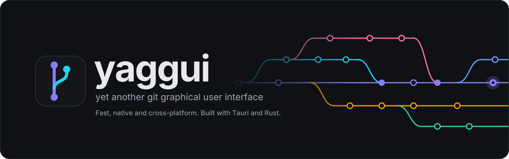
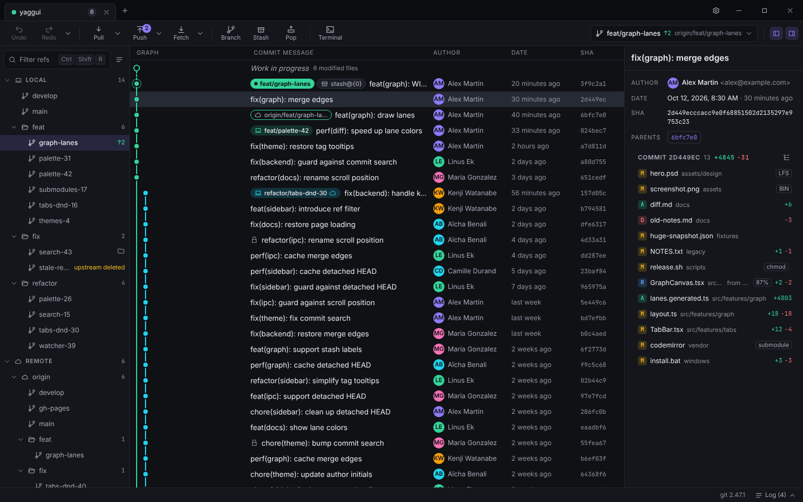
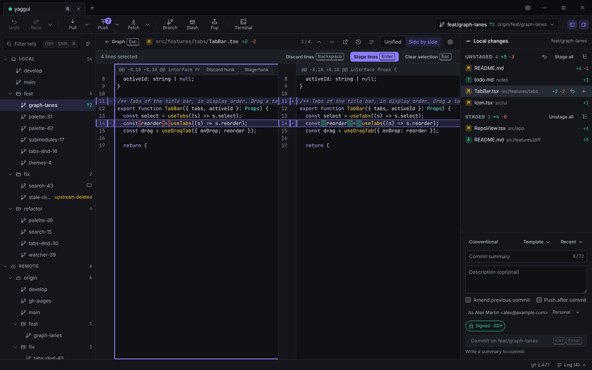
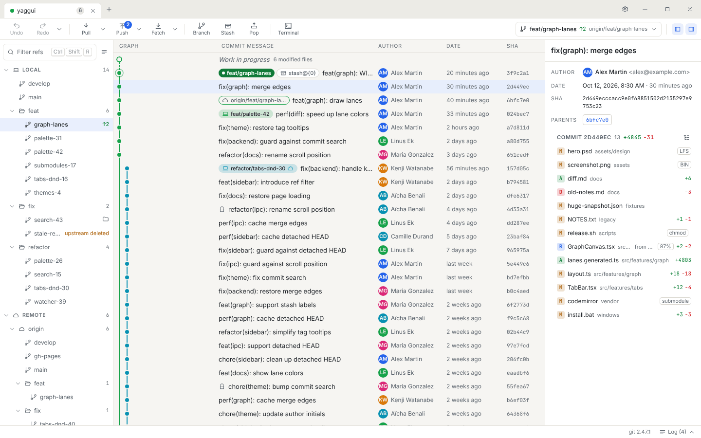

<p align="center">
  <picture>
    <source media="(prefers-color-scheme: dark)" srcset="docs/assets/banner-dark.svg">
    <source media="(prefers-color-scheme: light)" srcset="docs/assets/banner-light.svg">
    
  </picture>
</p>

**yaggui** is yet another git graphical user interface: a fast, native, cross-platform Git client in the spirit of GitKraken, but light, built with Tauri and Rust.



<table>
  <tr>
    <td></td>
    <td></td>
  </tr>
</table>

## Features

- **Commit graph** drawn on a canvas, smooth even on the Linux kernel history; drag a branch onto another to merge or rebase.
- **Staging by file, hunk or line**, straight from the diff.
- **Diff and 3-way merge editor**: unified or side by side, intra-line highlighting, image diffs.
- **Visual interactive rebase**: reorder, squash, reword and drop by drag & drop or keyboard.
- **Undo / redo** for local operations (commit, checkout, reset, discard, branch changes…).
- **Workspaces** to group repositories, open them as tabs and fetch them all.
- **Blame, file history and reflog**, plus submodules, worktrees and Git LFS.
- **Integrated terminal**, command palette (`⌘K` / `Ctrl+K`) and rebindable shortcuts.
- **Themes**: Graphite (dark), Paper (light), high contrast and Terminal; English and French.
- **Local and transparent**: no account, no telemetry; writes go through your own `git`, and every command it runs is logged.

## Install

Git 2.30+ must be installed.

### macOS (Homebrew)

```bash
brew install --cask simonvanmello/yaggui/yaggui
```

The cask comes from the [`homebrew-yaggui`](https://github.com/SimonVanMello/homebrew-yaggui) tap, which the command adds on its own. It installs the build for your Mac (Apple Silicon or Intel) into `/Applications`.

The app is not notarized yet, so Gatekeeper blocks it on first launch. Clear the quarantine attribute once:

```bash
xattr -dr com.apple.quarantine /Applications/yaggui.app
```

Update with `brew update && brew upgrade --cask yaggui`. Uninstall with `brew uninstall --cask yaggui`, or `brew uninstall --zap --cask yaggui` to also remove settings and caches.

### Arch Linux (AUR)

Install [`yaggui-bin`](https://aur.archlinux.org/packages/yaggui-bin), for example with `yay -S yaggui-bin`.

### Other platforms

Download the installer for your OS from the [latest release](https://github.com/SimonVanMello/yaggui/releases/latest): `.dmg` for macOS, `.exe` or `.msi` for Windows, `.deb`, `.rpm` or `.AppImage` for Linux.

The builds are not signed yet: on macOS, allow the app in System Settings → Privacy & Security on first launch; on Windows, SmartScreen asks for confirmation.

## Built with Claude

yaggui is written entirely by [Claude](https://claude.com/claude-code), Anthropic's AI, through Claude Code: specification, architecture, code, tests and documentation. A human sets the direction, reviews the work and tests the app. The instructions the agents follow are in [`CLAUDE.md`](CLAUDE.md), the requirements in [`docs/SPEC.md`](docs/SPEC.md) and the task breakdown in [`docs/PLAN.md`](docs/PLAN.md).

## Build from source

Prerequisites: [Rust](https://rustup.rs) 1.93+, [Node.js](https://nodejs.org) 22+, [pnpm](https://pnpm.io) 10 (`corepack enable`), Git 2.30+, and the [Tauri system dependencies](https://v2.tauri.app/start/prerequisites/) for your OS (WebView2 on Windows, Xcode Command Line Tools on macOS, WebKitGTK on Linux).

```bash
git clone https://github.com/SimonVanMello/yaggui.git
cd yaggui
pnpm install
pnpm tauri dev                     # run in development mode
pnpm tauri build                   # installers in src-tauri/target/release/bundle/
```

`pnpm dev` runs the frontend alone in a browser on a mocked backend (http://localhost:1430).

## License

[GPL-3.0-or-later](LICENSE)
